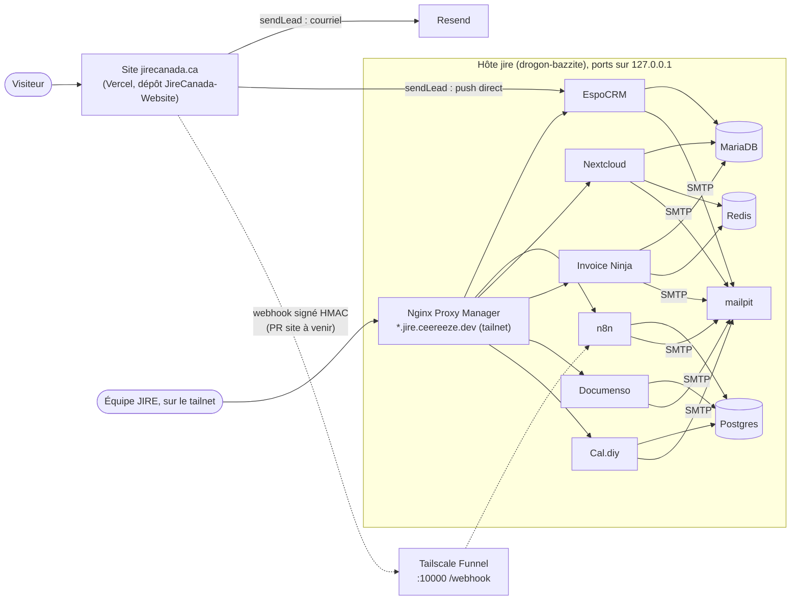
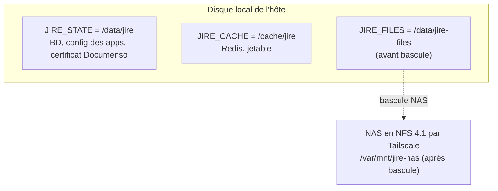

# Architecture de la stack « jire »

> Environnement de **test** : données **FICTIVES** uniquement, tout le courriel part dans
> mailpit. Ce document décrit ce qui est dans le dépôt aujourd'hui, et dit clairement ce qui
> reste à construire ou à trancher. Les marques **[à construire]** et **[à trancher]** ne
> sont pas des oublis : rien de tel n'existe encore dans le dépôt.

## Le cabinet en deux mots

JIRE est un cabinet de conseil en immigration (consultants agréés par la CICC) avec deux
branches liées : **Canada (CA)** et **Côte d'Ivoire (CI)**. Chaque outil reflète cette
séparation :

| Outil | Côté Canada | Côté Côte d'Ivoire |
| --- | --- | --- |
| Google Workspace (`jirecanada.ca`) | Unité organisationnelle `/Canada` | Unité organisationnelle `/Cote-d-Ivoire` |
| EspoCRM | Équipe `Canada` | Équipe `Cote-d-Ivoire` (colonne `equipe` des CSV de seed) |
| Invoice Ninja | Entreprise « JIRE Canada » : CAD, TPS 5 % + TVQ 9,975 %, factures `CA-F-xxxx` | Entreprise « JIRE Côte d'Ivoire » : XOF, TVA 18 %, factures `CI-F-xxxx` |
| Fichiers clients | `${JIRE_FILES}/ca/` | `${JIRE_FILES}/ci/` |
| Numéros de dossier | `CA-<ANNÉE>-<NNNN>` | `CI-<ANNÉE>-<NNNN>` |

Un dossier peut être **lié** entre les deux branches (exemple fictif du seed :
`CA-2026-0002` ↔ `CI-2026-0004`, facturé par CA). Le lien vit dans la colonne
`dossier_lie` d'EspoCRM et dans la fiche `00-FICHE.txt` du dossier.

Les unités organisationnelles Google, les équipes EspoCRM et les deux entreprises
Invoice Ninja **ne sont pas créées par ce dépôt** : c'est de la configuration dans les
applications, à faire à la main au premier démarrage **[à construire]**.

## Rôles

| Rôle | Peut faire | Ne fait pas |
| --- | --- | --- |
| Consultant agréé (CICC) | Donner des conseils en immigration, signer les mandats, préparer et soumettre à IRCC | — |
| Personnel non agréé | Accueil, prise de rendez-vous, collecte et classement des pièces | **Aucun conseil** en immigration |
| Administrateur technique | Exploiter la stack (comptes, sauvegardes, mises à jour) | Ne consulte pas les dossiers sans raison opérationnelle |

Cette séparation est une règle métier. Les droits fins dans chaque application (qui voit
quoi dans EspoCRM, Nextcloud, Invoice Ninja) ne sont **pas encore définis**
**[à trancher]** ; voir [runbooks/onboarding.md](runbooks/onboarding.md).

## Vue d'ensemble



Les flèches en pointillé n'existent pas encore : le webhook côté site est une PR à venir
dans JireCanada-Website, et le Funnel n'est pas configuré.

## Le parcours client, de A à Z

| # | Étape | Outil | État dans le dépôt |
| --- | --- | --- | --- |
| 1 | Le visiteur remplit le formulaire du site | Site (Vercel) | Existe (`sendLead`) |
| 2 | Le prospect arrive par courriel à l'équipe | Resend | Existe, côté site |
| 3 | Le prospect est créé dans le CRM | EspoCRM | Existe : `sendLead` pousse directement vers EspoCRM (best-effort) |
| 4 | Le site notifie aussi n8n (webhook signé) | n8n | **[à construire]** côté site ; aucun workflow n8n d'intake dans ce dépôt (voir plus bas) |
| 5 | Rendez-vous de consultation | Cal.diy, relié à Google Agenda | Service présent ; liaison Google Agenda **[à construire]** (configuration dans l'app) |
| 6 | Mandat signé | Documenso | Service présent, certificat de signature rendu depuis 1Password ; modèle de mandat **[à construire]** |
| 7 | Ouverture du dossier | Nextcloud + `JIRE_FILES` | Arborescence normalisée (voir plus bas) ; création automatique **[à construire]** (aujourd'hui seulement `scripts/seed-dossiers.sh` pour le test) |
| 8 | Dépôt des pièces par le client | Lien de partage Nextcloud | Manuel ; dépôt dans `depot-entrant/` ou dans `03-Pieces/` **[à trancher]** |
| 9 | Traitement et soumission à IRCC | Consultant agréé | Hors outillage ; pièces dans `05-Soumis-IRCC/` |
| 10 | Facture d'acompte, d'étape, de solde | Invoice Ninja | Service présent ; entreprises et taxes à configurer, CSV de seed fournis |
| 11 | Fermeture du dossier | Nextcloud | Déplacement vers `clients-fermes/` avec un `FERMETURE.txt` (date + 6 ans) |
| 12 | Conservation 6 ans, puis destruction | `JIRE_FILES` + sauvegardes | Date calculée dans `FERMETURE.txt` ; destruction **[à construire]**, voir [conformite.md](conformite.md) |

Statuts EspoCRM utilisés par le seed, dans l'ordre : « Mandat envoyé », « Mandat signé »,
« Collecte de pièces », « En traitement », « Soumis IRCC », « Fermé – approuvé »,
« Fermé – refusé ». Ce sont des valeurs de CSV : la liste de choix correspondante dans
EspoCRM reste à créer **[à construire]**.

### Pourquoi n8n ne crée pas les prospects

`sendLead` pousse déjà le prospect dans EspoCRM. Si un workflow n8n le créait aussi, chaque
demande ferait **deux fiches**. Décision de Célian : on garde le push direct de `sendLead`.
Le workflow n8n d'intake est donc volontairement absent ; quand le webhook arrivera, n8n
servira aux suites (accusé de réception, tâches, rappels), pas à la création du prospect.

### Contrat du webhook site → n8n

| Élément | Valeur |
| --- | --- |
| En-têtes | `X-Jire-Timestamp` (secondes Unix) et `X-Jire-Signature: sha256=<hex>` |
| Signature | `HMAC-SHA256(LEAD_WEBHOOK_SECRET, "${ts}.${rawBody}")` |
| Fenêtre | 300 s ; au-delà, la requête est rejetée |
| Secret | `LEAD_WEBHOOK_SECRET`, identique sur Vercel et dans `op://JireEnv/lead-webhook/secret` |
| Côté site | Envoi facultatif, timeout court, jamais bloquant pour le courriel Resend |

n8n reçoit déjà `LEAD_WEBHOOK_SECRET` et a le droit d'utiliser `crypto` dans ses nœuds
(`NODE_FUNCTION_ALLOW_BUILTIN`), ce qui suffit pour vérifier la signature.

## Les services

| Service | Rôle | Port local | Sous-domaine (défaut du compose) | Base |
| --- | --- | --- | --- | --- |
| `espocrm` + `espocrm-daemon` | CRM : prospects, clients, équipes CA/CI ; le daemon lance les tâches planifiées | 8080 | `crm.jire.ceereeze.dev` | MariaDB `espocrm` |
| `n8n` | Automatisations, réception du webhook du site | 5678 | `n8n.jire.ceereeze.dev` | Postgres `n8n` |
| `nextcloud` + `nextcloud-cron` | Fichiers clients et liens de dépôt ; le cron lance les tâches de fond | 8082 | `cloud.jire.ceereeze.dev` | MariaDB `nextcloud` |
| `invoiceninja` + `invoiceninja-web` | Facturation CA et CI ; Nginx sert l'app PHP-FPM | 8083 | `factures.jire.ceereeze.dev` | MariaDB `invoiceninja` |
| `documenso` | Signature électronique des mandats | 8084 | `sign.jire.ceereeze.dev` | Postgres `documenso` |
| `caldiy` | Prise de rendez-vous ; image construite depuis le dépôt Cal.diy au commit `2e412471` | 8085 | `rdv.jire.ceereeze.dev` | Postgres `caldiy` |
| `mailpit` | Capture tout le SMTP de la stack pendant le test | 8025 | aucun défini **[à trancher]** | fichier SQLite dans l'état |
| `postgres`, `mariadb` | Une base et un utilisateur par application, créés au premier démarrage (`config/*/init-databases.sh`) | — | — | — |
| `redis` | Cache et files : index 0 pour Nextcloud, 1 et 2 pour Invoice Ninja | — | — | — |

### Exposition réseau

| Couche | Ce qui est en place | Ce qui ne l'est pas |
| --- | --- | --- |
| Ports Docker | Tous liés à `127.0.0.1` : rien n'écoute sur le réseau de l'hôte | — |
| Nginx Proxy Manager | Existe déjà sur l'hôte (homelab), sert `*.jire.ceereeze.dev` au tailnet | Les hôtes proxy jire ne sont **pas** configurés par ce dépôt |
| Tailscale Funnel | Prévu : port **10000** (le 8443 est déjà pris), chemin `/webhook` de n8n seulement | **Pas configuré**. `WEBHOOK_URL` pointe sur un nom factice (`jire-host.example.ts.net`) |
| Tailnet | Aujourd'hui celui du homelab | Un tailnet au nom de la firme est prévu **[à construire]** |

La commande Funnel envisagée, à vérifier avec `tailscale funnel --help` sur l'hôte avant
de l'exécuter (et seulement avec le feu vert de Célian) :

```bash
tailscale funnel --bg --https=10000 --set-path=/webhook http://127.0.0.1:5678/webhook
```

Seul `/webhook` doit être public : l'interface de n8n et `/webhook-test` restent sur le
tailnet.

### Courriel

Pendant le test, chaque service envoie à `mailpit:1025` et rien ne sort. Le relais Google
Workspace (`smtp-relay.gmail.com:587`) est seulement commenté dans `.env.template` ; l'activer
demandera aussi de changer les hôtes SMTP de chaque service dans `docker-compose.yml`. Pas de
serveur de courriel auto-hébergé : le courriel réel du cabinet est Google Workspace.

## État, cache et fichiers clients



| Variable | Défaut | Contenu | Sauvegardé | Règle |
| --- | --- | --- | --- | --- |
| `JIRE_STATE` | `/data/jire` | `<svc>/` par service, `_dumps/` des BD | Oui, sauf `postgres/` et `mariadb/` bruts (remplacés par les dumps) | **Jamais sur NFS** : Ansible refuse un système de fichiers réseau |
| `JIRE_CACHE` | `/cache/jire` | Données Redis | Non | Jetable |
| `JIRE_FILES` | `/data/jire-files` | Dossiers clients | Oui | **Seul chemin qui change** lors de la bascule vers le NAS |

Pourquoi cette séparation : une base de données sur NFS se corrompt au premier hoquet
réseau, alors que des fichiers clients le supportent. Garder l'état en local et ne déplacer
que `JIRE_FILES` rend la bascule NAS simple et réversible
([runbooks/bascule-nas.md](runbooks/bascule-nas.md)).

### Qui monte `JIRE_FILES`

| Service | Chemin dans le conteneur | Utilisateur |
| --- | --- | --- |
| `nextcloud`, `nextcloud-cron` | `/mnt/jire-files`, ajouté par l'app « External storage » (stockage local). Le répertoire de données de Nextcloud reste dans `JIRE_STATE` | `www-data` (uid 33) |
| `n8n` | `/files` | `node` (uid 1000) |

Deux uid différents écrivent au même endroit. Le schéma de droits (groupe partagé avec
setgid et ACL, ou `group_add`) **n'est pas tranché** **[à trancher]** ; il conditionne aussi
les options d'export du NAS.

### Arborescence

```text
${JIRE_FILES}/
├── .jire-files              fichier témoin : son absence = NAS non monté
├── ca/
│   ├── clients-actifs/
│   │   └── CA-2026-0001 TREMBLAY Julie - Entree express/
│   │       ├── 00-FICHE.txt
│   │       ├── 01-Mandat/
│   │       ├── 02-Identite/
│   │       ├── 03-Pieces/
│   │       ├── 04-Correspondance/
│   │       ├── 05-Soumis-IRCC/
│   │       └── 06-Facturation/
│   └── clients-fermes/
│       └── <dossier>/FERMETURE.txt   date de fermeture + conservation jusqu'au
├── ci/                      même structure que ca/
├── depot-entrant/           pièces reçues, pas encore classées
└── modeles/                 modèles de documents (mandat, lettres)
```

Un dossier s'appelle `<BRANCHE>-<ANNÉE>-<NNNN> NOM Prenom - Programme`, **en ASCII**
(`seed-dossiers.sh` refuse un nom avec accents : les noms passent par NFS, Nextcloud et des
liens de partage).

## Secrets

| Quoi | Où |
| --- | --- |
| Toutes les valeurs secrètes | Coffre 1Password **JireEnv** (jamais HomelabEnv), en références `op://JireEnv/...` dans `.env.template` |
| `.env` rendu | `scripts/render-env.sh` → `op inject`, mode `0600`, jamais commité. Ansible refuse un `.env` lisible par d'autres |
| Certificat de signature Documenso | `op://JireEnv/documenso/cert.p12` → `${JIRE_STATE}/documenso/cert.p12`, mode `0400`, propriétaire uid 1001 |
| Variables Restic | `hosts/jire/restic.env.template`, passées par `op run`, jamais écrites sur disque |

gitleaks scanne tout l'historique à chaque PR.

## Séparation d'avec le homelab

La stack tourne sur un hôte du homelab (`drogon-bazzite`, sous Bazzite, système immuable où
`/mnt` pointe vers `/var/mnt`) mais n'en partage ni les secrets ni les sauvegardes :

| Ressource | Homelab | jire |
| --- | --- | --- |
| Coffre 1Password | HomelabEnv | **JireEnv** |
| Dépôt Restic et bucket | Ceux du homelab | Distincts (`op://JireEnv/restic/*`) |
| Réseau Docker | — | `jire`, dédié |
| Tailnet | Celui du homelab | Aujourd'hui partagé ; un tailnet de la firme est prévu |
| Nginx Proxy Manager | Partagé | Partagé (seul point commun d'exploitation) |

## Images et mises à jour

Chaque image est épinglée par digest (`nom:tag@sha256:...`). Cal.diy fait exception : aucune
image n'est publiée, donc on la construit depuis son dépôt à un commit épinglé (build long,
jusqu'à 6 Go de RAM, **jamais testé sur l'hôte**). Le compose annonce des mises à jour par
Renovate ; `renovate.json` n'existe pas encore.

## Sauvegardes

`scripts/backup.sh` fait un dump logique de Postgres et MariaDB dans `${JIRE_STATE}/_dumps`,
puis sauvegarde `JIRE_STATE` et `JIRE_FILES` vers le dépôt Restic de la stack. Il refuse de
tourner si le fichier témoin `.jire-files` est absent. Rétention : 7 quotidiennes,
5 hebdomadaires, 12 mensuelles, 7 annuelles. `scripts/restore-test.sh` restaure le dernier
instantané dans un dossier temporaire et vérifie qu'il est exploitable. La restauration
réelle est décrite dans [runbooks/restauration.md](runbooks/restauration.md). Aucune
planification (timer systemd, cron) n'est en place **[à construire]**.
